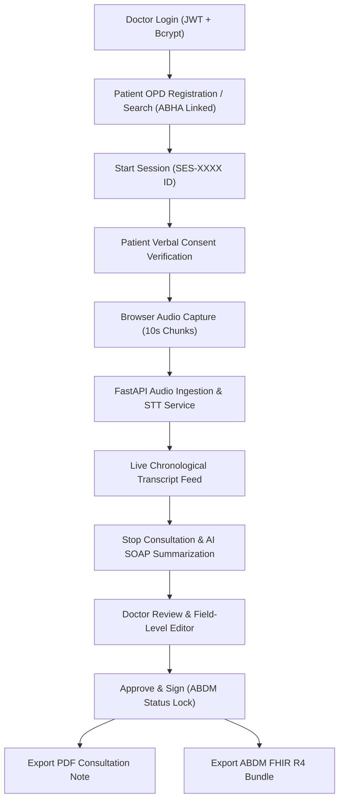

# Ambient AI Voice Scribe - Comprehensive Project Status & Roadmap Report

**Project Title**: Ambient AI Voice Scribe for Indian Public Healthcare Facilities  
**Standard**: Aligned to National Health Authority (NHA) EOI (Standalone Voice Scribe Category)  
**Date**: October 14, 2026  
**Status**: Initial Architecture & Core Functional Skeleton Completed (Phase 1 Ready)

---

## 1. Executive Summary & Progress Overview

| Phase / Milestones | Status | Completion % | Key Artifacts |
| :--- | :--- | :---: | :--- |
| **Phase 0: Environment & Scaffold** | ✅ Completed | 100% | Linux venv, Node 20 runtime, `.gitignore`, `.env.example`, `docker-compose.yml` |
| **Phase 1: Backend Foundation & API** | ✅ Completed | 100% | FastAPI, SQLAlchemy models (5 tables), Pydantic schemas, direct bcrypt auth, `/health` |
| **Phase 2: Frontend PWA & UX** | ✅ Completed | 100% | React 18 + Vite, glassmorphic design system, `useRecorder` hook, 4 primary pages |
| **Phase 3: Integration & Tests** | ✅ Completed | 100% | 5/5 Pytest test cases passing, Vite production build verified (`built in 1.44s`) |
| **Phase 4: ML Models (Whisper + Ollama)** | 🟡 Scaffolded (Fallback Active) | 40% | Service layer ready; model weights & daemons need local setup/download |
| **Phase 5: Evaluation & Field Testing** | ⚪ Pending | 0% | Benchmark dataset (5 mock audios), WER calculation (`jiwer`), latency benchmarks |

---

## 2. Detailed Breakdown: What Parts Are Done

### A. Backend Layer (`backend/app/`)
* **Core Application (`main.py`)**:
  * FastAPI application with lifespan database initialization and CORS configured.
  * Health check route `/health` returning status ok.
  * Seed data generator for quick testing:
    * Doctor: `doctor@hospital.gov.in` / `doctor123` (*AIIMS*)
    * Patient: `PID-1001` (*Ramesh Kumar*, ABHA: `14-5521-8890-1234`).
* **Database & ORM (`database.py`, `models.py`)**:
  * SQLite configured for instant local dev, easily swappable with PostgreSQL via `.env`.
  * All 5 specified database tables implemented with relationships and foreign keys:
    1. `doctors` (id, name, email, password_hash, hospital, created_at)
    2. `patients` (id, name, age, gender, abha_id, created_at)
    3. `sessions` (id, patient_id, doctor_id, language, status, started_at, ended_at, audio_path)
    4. `transcripts` (id, session_id, chunk_no, text, timestamp)
    5. `notes` (id, session_id, summary_json, edited_json, status, fhir_json, updated_at).
* **Authentication & Security (`auth.py`, `routers/auth.py`)**:
  * Native `bcrypt` password hashing (clean salt generation, avoids legacy passlib deprecations).
  * JWT Bearer token generation with 24-hour expiry and dependency injection (`get_current_doctor`).
* **Clinical Schemas (`schemas.py`)**:
  * Strict Pydantic V2 schemas (`ConfigDict(from_attributes=True)`).
  * Standardized SOAP note schema: `chief_complaint`, `history_of_present_illness`, `symptoms`, `examination`, `diagnosis`, `medications` (with dosage, frequency, duration), `investigations`, `advice`, `follow_up`.
* **API Routers (`routers/`)**:
  * `patients.py`: OPD walk-in registration, ABHA search, and patient retrieval.
  * `sessions.py`: Consultation lifecycle (`POST /sessions`, `POST /sessions/{id}/stop`, `GET /transcript`).
  * `audio.py`: Multipart audio chunk receiver, auto-increments chunk sequence number, stores audio files in `data/audio/<session_id>/`, runs transcription, and stores ordered records.
  * `notes.py`: Fetch note draft, edit fields (`PUT`), approve note (`POST /approve`), and export.
* **Services (`services/`)**:
  * `stt_service.py`: Faster-Whisper wrapper with multilingual support and simulated fallback.
  * `summarizer.py`: Ollama integration with strict zero-hallucination prompt and heuristic fallback.
  * `fhir_service.py`: Converts approved note into an **ABDM-compliant FHIR R4 Document Bundle** (Composition, Patient, Practitioner, Condition, MedicationRequest).
  * `pdf_service.py`: Generates clinical consultation notes with hospital header, prescription table, and doctor digital signature block.
* **Prompt Engineering (`prompts/soap_prompt.txt`)**:
  * Strict zero-hallucination clinical prompt instructing model to translate non-English spoken consultation into medical English and output strict JSON matching the schema.

### B. Frontend Layer (`frontend/`)
* **Design System (`src/index.css`)**:
  * Curated clinical glassmorphism with dark-mode aesthetic (`#0a0f1d`, `#111a33`, teal accents `#0d9488`).
  * CSS micro-animations: Pulsing recording glow, audio visualizer wave bars, and badge indicators.
* **State Machine & Audio Capture (`src/hooks/useRecorder.js`)**:
  * Native browser `MediaRecorder` API capturing 10-second chunks (WebM/Opus).
  * Web Audio API (`AudioContext` and `AnalyserNode`) calculating real-time microphone decibel levels.
* **Interactive Views (`src/pages/`)**:
  * `Login.jsx`: Doctor sign-in with 1-click AIIMS demo account button.
  * `PatientSelect.jsx`: OPD patient selection, registration form, and language picker (English, Hindi, Bengali, Tamil, Telugu, Marathi).
  * `Recorder.jsx`: Consultation room with live streaming transcript chunks, real-time audio waveform meter, and patient info header.
  * `NoteEditor.jsx`: Doctor review form, dynamic medications table (add/remove rows), draft save, ABDM approve lock, and export actions.
* **Components (`src/components/`)**:
  * `ConsentModal.jsx`: ABDM privacy checklist compliance (patient verbal consent check).
  * `RecordButton.jsx`: Glowing toggle button with formatted timer.
  * `TranscriptBox.jsx`: Auto-scrolling chronological transcript chunk viewer.
  * `NoteForm.jsx`: Full editable clinical note form.
  * `Header.jsx`: Doctor badge, hospital identifier, and logout trigger.

### C. Testing & DevOps
* **Automated Tests (`backend/tests/`)**:
  * `test_api.py`: Verified `/health`, `/auth/login`, and `/patients` session flow.
  * `test_stt.py`: Verified STT service initialization.
  * `test_summarizer.py`: Verified clinical JSON schema parsing.
  * **Result**: **5 Passed, 0 Failed**.
* **Frontend Verification**:
  * Executed `npm run build` using native Node 20 in WSL: `✓ built in 1.44s` with zero errors.
* **Deployment Config**:
  * Multi-stage `backend/Dockerfile` with FFmpeg.
  * Multi-stage `frontend/Dockerfile` with Nginx.
  * `docker-compose.yml` linking backend, frontend, and Ollama.

---

## 3. Tools and Technologies Used

### A. Current Stack (Implemented & Working)

| Domain | Tool / Library | Version | Purpose in Project |
| :--- | :--- | :---: | :--- |
| **OS & Runtime** | WSL Ubuntu 24.04 + Node.js | v20.18.0 | Native Linux execution environment on Windows |
| **Backend Framework** | FastAPI | 0.143.0 | High-performance ASGI REST API controller |
| **ASGI Server** | Uvicorn | 0.54.0 | Development and production ASGI server |
| **ORM & Database** | SQLAlchemy + SQLite | 2.1.4 | Relational persistence for 5 tables |
| **Validation** | Pydantic V2 | 2.14.0 | Schema enforcement for JSON notes & endpoints |
| **Authentication** | `python-jose` + `bcrypt` | 3.5.0 / 5.0.0 | JWT generation and cryptographic password hashing |
| **HTTP Client** | HTTPX | 0.28.1 | Async communication with Ollama and test client |
| **Testing** | Pytest + Pytest-Asyncio | 9.1.1 | Automated testing and verification |
| **Frontend Framework**| React 18 | 18.2.0 | Reactive component architecture |
| **Build Bundler** | Vite | 5.4.21 | Rapid HMR dev server and optimized Rollup build |
| **Icons** | Lucide React | 0.363.0 | Modern healthcare and UI iconography |
| **Styling** | Vanilla CSS Glassmorphism | Custom | Design system tailored to clinical workflows |
| **Audio Capture** | MediaRecorder + Web Audio API | Browser Native | 10s audio chunking and real-time audio visualizer |
| **Interop Standard** | ABDM FHIR R4 Profiles | R4 Spec | Outpatient Consultation Document Bundle format |

---

## 4. What We Need From Now & Required Tools

### A. Next Immediate Steps (Phase 4 & 5)

1. **Push Initial Scaffolding to Git**:
   * Commit the verified initial files from WSL to your GitHub repository `main` branch.
2. **Install Local AI Model Engines**:
   * **Speech-to-Text**: Install `faster-whisper` and FFmpeg in WSL to test live audio transcription with real Whisper model weights (`base` or `small`).
   * **AI Summarizer**: Install and launch **Ollama** (`curl -fsSL https://ollama.com/install.sh | sh`) and pull the model (`ollama pull llama3:8b` or `qwen2.5:7b`).
3. **Assemble Test Audio Dataset** (Per Section 9, Step 4 of Project Plan):
   * Gather 5 mock consultation recordings (English, Hindi, Bengali) in `data/audio/mock_tests/`.
   * Benchmark **Word Error Rate (WER)** using `jiwer`.
4. **End-to-End Latency & Accuracy Tuning**:
   * Benchmark the 30-second target: Time from tapping "Finish Consultation" to the structured note appearing on the screen.
5. **Doctor Audit Logging**:
   * Add an audit trail table to record when a note was edited, which fields were altered, and when the ABDM digital signature was appended.

### B. Additional Tools / Packages Needed for Upcoming Steps

| Tool / Package | Source / Installation | Reason Needed |
| :--- | :--- | :--- |
| **FFmpeg** | `sudo apt install ffmpeg` | Audio transcoding (WebM from browser -> 16kHz WAV for Whisper) |
| **faster-whisper** | `pip install faster-whisper` | Local, high-performance CTranslate2 Whisper inference |
| **Ollama** | `ollama.com` / Docker | Local host for Llama-3 / Qwen without third-party API leaks |
| **jiwer** | `pip install jiwer` | Word Error Rate (WER) scoring against ground truth transcripts |
| **ReportLab** | `pip install reportlab` | Production PDF rendering engine |
| **HL7 FHIR Validator / fhir.resources** | `pip install fhir.resources` | Validating generated bundles against ABDM schema profiles |

---

## 5. Summary Checklist of Next Actions

- [ ] **Action 1**: Run `git add . && git commit -m "feat: initial scaffold" && git push origin main`.
- [ ] **Action 2**: Install FFmpeg in Ubuntu: `sudo apt-get update && sudo apt-get install -y ffmpeg`.
- [ ] **Action 3**: Install `faster-whisper` in `.venv`: `source .venv/bin/activate && pip install faster-whisper`.
- [ ] **Action 4**: Start Ollama locally or configure an API fallback in `.env`.
- [ ] **Action 5**: Conduct first real microphone consultation test via `http://localhost:5173`.
